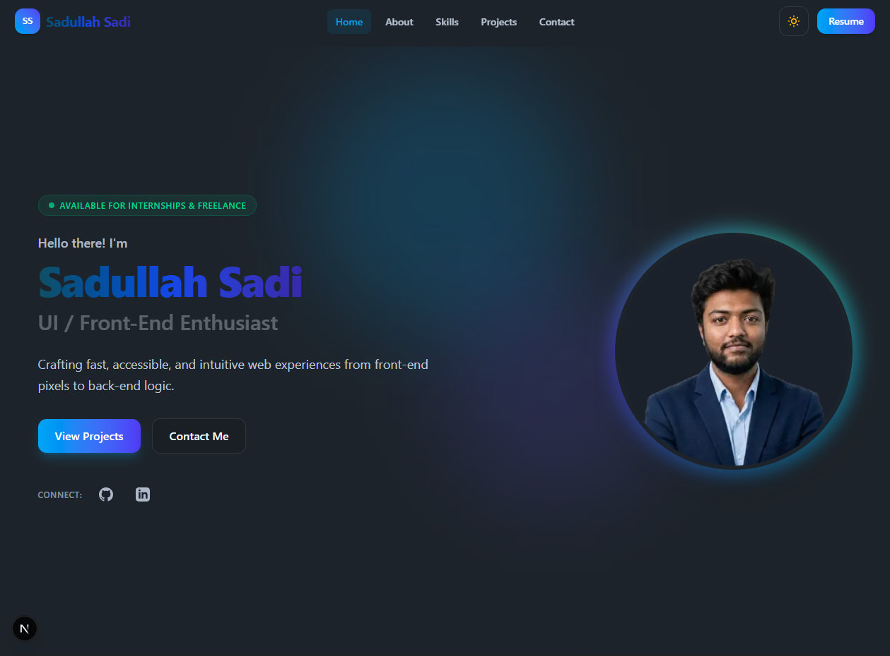
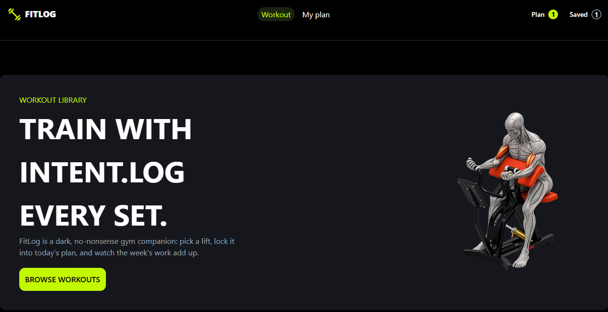
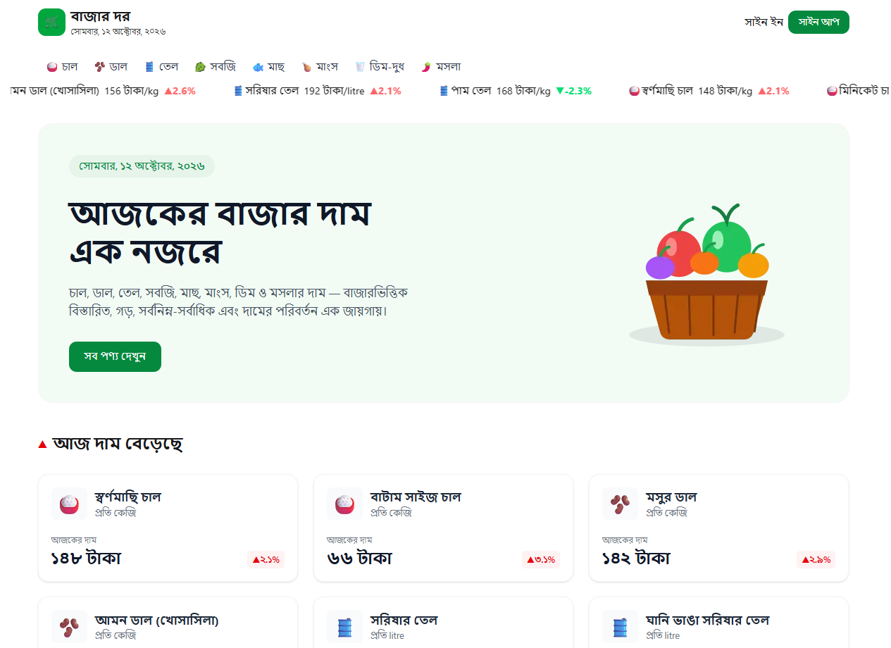

<div align="center">

# 🌐 Personal Portfolio Website

<p align="center">
  <strong>A modern, responsive personal portfolio built with Next.js 16, React 19, Tailwind CSS v4.</strong>
</p>

<p align="center">
  <a href="https://nextjs.org/"></a>
  <a href="https://react.dev/"></a>
  <a href="https://www.typescriptlang.org/"></a>
  <a href="https://tailwindcss.com/"></a>
  <a href="https://daisyui.com/"></a>
  
  
</p>

---

### 🚀 Live Demo
> **[Live Demo](https://my-portfolio-ten-fawn-83.vercel.app/)** 

---

</div>

## 📑 Table of Contents

- [About the Project](#-about-the-project)
  - [Key Features](#key-features)
- [Tech Stack](#-tech-stack)
- [Screenshots](#-screenshots)
- [Project Structure](#-project-structure)
- [Getting Started](#-getting-started)
  - [Prerequisites](#prerequisites)
  - [Installation](#installation)
  - [Development Server](#development-server)
  - [Available Scripts](#available-scripts)
- [Configuration & Customization](#-configuration--customization)
- [Contact](#-contact)
- [License](#-license)

---

## 💡 About the Project

This is a personal developer portfolio designed and engineered to showcase software projects, technical skillsets, educational background, and contact avenues in a clean, high-performance single-page experience.

Built leveraging the latest **Next.js 16 App Router**, **React 19**, and the modern **Tailwind CSS v4** engine with **DaisyUI 5**, the site emphasizes fast load times, accessible UI patterns, and fluid animations.

### Key Features

- 🌓 **Theme Switcher**: Instant Dark / Light mode toggle powered by DaisyUI themes and persisted via `localStorage` with system synchronization.
- 🔄 **Dynamic Hero Section**: Interactive introduction featuring cycling title animations, status indicator badge, and direct resume download.
- 🎯 **Scrollspy Navigation**: Sticky header with real-time active section tracking and responsive mobile navigation drawer.
- 🛠️ **Categorized Skills Matrix**: Grouped technical proficiencies across Frontend, Backend, Database, and Tools with experience badges.
- 💻 **Project Showcase**: Rich cards displaying featured projects with screenshots, descriptive tags, live demo links, and GitHub repository shortcuts.
- ✉️ **Interactive Contact Form**: Client-validated inquiry form (validating name, email format, and message length) alongside direct email and social reach-out links.
- 📄 **Centralized Content Store**: All portfolio data, projects, skills, and links reside in a single typed configuration file (`src/data/portfolio.ts`) for easy maintenance.

---

## 🛠️ Tech Stack

### Frontend & Core
| Technology | Description |
| :--- | :--- |
|  | React framework with App Router, server-rendered layouts, and optimized fonts |
|  | UI library with modern client hooks and state management |
|  | Strict static typing for resilient component interfaces and project data |

### Styling & UI
| Technology | Description |
| :--- | :--- |
|  | Utility-first CSS framework using the next-generation engine |
|  | Semantic UI component library for Daisy themes and components |
| **Geist Font** | Variable typography via `next/font/google` |

### Tooling & Build
| Technology | Description |
| :--- | :--- |
|  | Code linting and style enforcement (`eslint-config-next`) |
| **Turbopack** | Next-generation bundler support (`@tailwindcss/turbopack`) |
| **React Compiler** | Experimental build optimizations (`babel-plugin-react-compiler`) |

---

## 📸 Screenshots

<!-- Note: Place a screenshot of your portfolio landing page in public/ and embed it here -->
> _Portfolio preview screenshot placeholder:_
>
> ```markdown
> 
> ```

### Featured Project Assets (Included in Project)

| FitLog Tracker | Bazar Dor Storefront |
| :---: | :---: |
|  |  |

---


## 📬 Contact

**Sadullah Sadi**  
*CSE Student & Full Stack Web Developer*  
📍 Mymensingh, Bangladesh  

- 📧 **Email**: [sadullasadi99@gmail.com](mailto:sadullasadi99@gmail.com)
- 💼 **LinkedIn**: [linkedin.com/in/sadullah-sadi](https://www.linkedin.com/in/sadullah-sadi)
- 🐙 **GitHub**: [@sadi-logic](https://github.com/sadi-logic)

---
